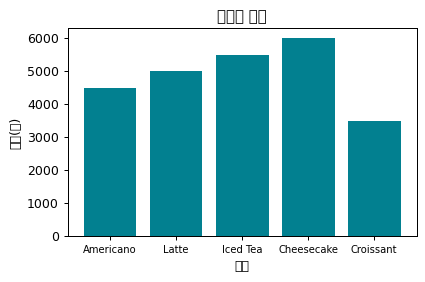

# 0-6 한글이 깨질 때

!!! abstract "이 절에서 할 일"
    한글은 두 곳에서 깨진다. **CSV 파일**에서 깨지는 것과 **차트 글자**가 깨지는 것은 원인도 해결도 다르다. 둘을 구분해 둔다.

| 어디서 | 증상 | 이 연습장의 해결 |
|---|---|---|
| CSV 파일 | 엑셀에서 열면 한글이 `카페` 처럼 깨진다 · 파이썬에서 `UnicodeDecodeError` | 실습 CSV 는 모두 UTF-8(BOM 포함)로 저장했다. 읽을 때 `encoding="utf-8-sig"`, 저장할 때도 `to_csv(..., encoding="utf-8-sig")` |
| 차트 글자 | 제목 · 축 이름이 네모(□)로 나온다 | Colab 기본 글꼴에 한글이 없기 때문이다. **차트 라벨은 영어로** 쓴다. 설치할 것이 없다 |

## 차트에서 깨지는 모습

0-3 의 `menu` 로 막대를 그려 본다. 제목과 축 이름을 한글로 쓰면 첫 번째 그림처럼, 영어로 쓰면 두 번째 그림처럼 나온다.

```python
import matplotlib.pyplot as plt
fig, ax = plt.subplots(figsize=(5, 3))
ax.bar(menu["menu"], menu["price"], color="#028090")
ax.set(title="Price by menu", xlabel="Menu", ylabel="Price (KRW)")   # 라벨은 영어로
plt.show()
```

<div class="grid" markdown>
{ width="380" }
{ width="380" }
</div>

<div class="say" data-who="fly">표에서는 한글이 멀쩡하잖아. 차트만 깨지는 거 맞아?</div>
<div class="say" data-who="doc">맞아요. 표는 브라우저 글꼴로, 차트는 그림 안 글꼴로 그려서 그래요.</div>

!!! tip "꼭 한글 라벨이 필요하면 (선택)"
    아래 셀을 한 번 먼저 실행한다. 이 연습장의 결과 그림은 이 셀 없이 만들었다.

    ```python
    # (선택) 차트에 꼭 한글을 써야 할 때만
    !apt-get -qq install fonts-nanum > /dev/null
    import matplotlib.pyplot as plt
    import matplotlib.font_manager as fm
    fm.fontManager.addfont("/usr/share/fonts/truetype/nanum/NanumGothic.ttf")
    plt.rcParams["font.family"] = "NanumGothic"
    plt.rcParams["axes.unicode_minus"] = False   # 마이너스 기호 깨짐 방지
    ```

!!! tip "바꿔 보기"
    `title="Price by menu"` 를 `title="메뉴별 가격"` 으로 바꿔 실행해 네모 글자를 직접 확인한다. 확인했으면 영어로 되돌린다.

<label class="done"><input type="checkbox" data-step="0-6"> 0-6 을 끝냈어요</label>

<div class="outro" markdown>
0편 정리

<div class="say" data-who="doc">① 위에서 아래로 실행한다 ② 오류는 맨 아래 줄부터 읽는다 ③ 한글은 두 곳에서 깨진다</div>
<div class="say" data-who="asst">업로드 셀까지 됐어요. 메뉴판 다섯 줄이 다 보여요.</div>
<div class="say" data-who="fly">카페 장부엔 뭐가 적혀 있을까?</div>

[1편 카페 Koi의 장부를 연다 →](../ep1/index.md)
</div>
