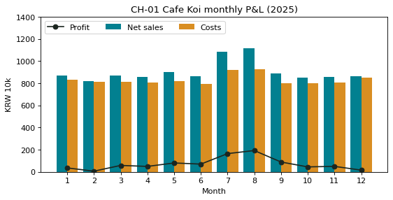

# 1-11 월별 손익표와 CH-01 월별 손익 막대

!!! abstract "이 절에서 할 일"
    월별로 순매출 · 재료비 · 고정비를 모아 손익표를 만들고, CH-01 그림 한 장으로 그린다.

```python
# 월별로 묶어 더한다
m["month"] = m["date"].dt.month
fixed = pd.read_csv("koi_fixed.csv", encoding=enc)
pl = m.groupby("month")[["net", "cogs"]].sum()
pl["fixed"] = fixed.groupby("month")["amount"].sum()
pl["profit"] = pl["net"] - pl["cogs"] - pl["fixed"]
print((pl / 10000).round(1))     # 만원 단위로 보기
```

```text title="실행 결과"
          net   cogs  fixed  profit
month                              
1       869.0  284.7  548.6    35.7
2       818.6  263.5  548.7     6.4
3       870.4  282.6  529.5    58.4
4       856.4  275.9  531.2    49.3
5       900.4  291.5  528.5    80.4
6       863.2  263.2  529.8    70.2
7      1082.9  330.0  588.0   164.9
8      1116.0  336.0  587.5   192.6
9       890.2  270.9  530.3    89.0
10      848.0  273.0  530.1    45.0
11      858.0  278.5  529.7    49.7
12      865.0  280.1  569.0    15.8
```

CH-01. 막대는 순매출과 비용(재료비 + 고정비), 선은 이익이다. 라벨은 영어로 쓴다(0-6).

```python
import matplotlib.pyplot as plt
k = pl / 1e4                      # 만원
fig, ax = plt.subplots(figsize=(8, 3.6))
x = k.index
ax.bar(x - 0.2, k["net"], width=0.4, label="Net sales", color="#028090")
ax.bar(x + 0.2, k["cogs"] + k["fixed"], width=0.4, label="Costs", color="#D98E22")
ax.plot(x, k["profit"], marker="o", color="#1C2620", label="Profit")
ax.axhline(0, color="gray", linewidth=0.8)
ax.set(title="CH-01 Cafe Koi monthly P&L (2025)", xlabel="Month", ylabel="KRW 10k", xticks=list(x), ylim=(0, 1400))
ax.legend(ncol=3, loc="upper left")
plt.show()
```



<div class="say" data-who="asst">7 · 8월 이익이 165만원, 193만원으로 제일 커요.</div>
<div class="say" data-who="fly">근데 이 합계, 믿어도 돼? 아직 검증 안 했잖아.</div>

!!! info "읽는 법"
    한 해 이익은 857만원이다. 여름에 아이스티와 손님이 늘어 7 · 8월이 가장 좋고, 고정비가 비슷한데 매출이 낮은 2월이 가장 작다(6만원).

!!! tip "바꿔 보기"
    `pl.sort_values("profit")` 을 실행해 이익이 작은 달부터 늘어놓아 본다.

<label class="done"><input type="checkbox" data-step="1-11"> 1-11 끝냈어요</label>
