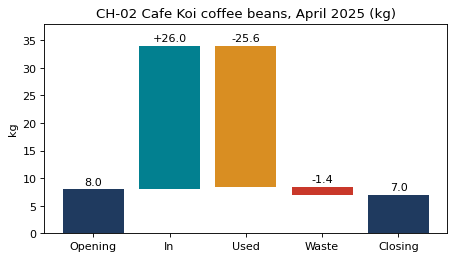

# 1-13 CH-02 재고 폭포

!!! abstract "이 절에서 할 일"
    4월 원두 재고를 기초 + 입고 − 사용 − 폐기 = 기말 로 맞춰 보고, 실제로 센 재고와 같은지 확인한 뒤 폭포 그림으로 그린다.

```python
st = pd.read_csv("koi_stock.csv", encoding=enc)
kg = st.groupby("type")["kg"].sum().round(1)
print(kg)
calc = round(kg["opening"] + kg["in"] - kg["used"] - kg["waste"], 1)
print("calculated closing:", calc, "/ counted:", kg["count"], "/ same:", calc == kg["count"])
```

```text title="실행 결과"
type
count       7.0
in         26.0
opening     8.0
used       25.6
waste       1.4
Name: kg, dtype: float64
calculated closing: 7.0 / counted: 7.0 / same: True
```

CH-02. 막대마다 바닥(`bottom`)을 앞 막대가 끝난 높이로 두면 폭포가 된다.

```python
steps  = ["Opening", "In", "Used", "Waste", "Closing"]
height = [kg["opening"], kg["in"], kg["used"], kg["waste"], calc]
bottom = [0, kg["opening"], kg["opening"] + kg["in"] - kg["used"], calc, 0]
colors = ["#1F3A5F", "#028090", "#D98E22", "#C9382A", "#1F3A5F"]
fig, ax = plt.subplots(figsize=(6.5, 3.4))
ax.bar(steps, height, bottom=bottom, color=colors)
for i, (h, b) in enumerate(zip(height, bottom)):
    sign = "-" if steps[i] in ("Used", "Waste") else ("+" if steps[i] == "In" else "")
    ax.text(i, b + h + 0.8, f"{sign}{h:.1f}", ha="center")
ax.set(title="CH-02 Cafe Koi coffee beans, April 2025 (kg)", ylabel="kg", ylim=(0, 38))
plt.show()
```



<div class="say" data-who="fly">계산이랑 실제로 센 재고가 다르면 어떡해?</div>
<div class="say" data-who="doc">그 차이가 바로 찾아야 할 일이에요. 이번엔 7.0kg 로 같네요.</div>

!!! info "읽는 법"
    기초 8.0 + 입고 26.0 − 사용 25.6 − 폐기 1.4 = 7.0kg 이 4월 30일에 실제로 센 7.0kg 과 같다. 폭포 그림은 "어디서 늘고 어디서 줄었나"를 한 줄로 보여 준다.

!!! tip "바꿔 보기"
    `koi_stock.csv` 에서 폐기 한 줄을 빼먹었다고 가정하고 `kg["waste"]` 대신 `0.8` 을 넣어 본다. 계산값과 센 값이 어긋난다.

<label class="done"><input type="checkbox" data-step="1-13"> 1-13 끝냈어요</label>

<div class="outro" markdown>
1편 정리

<div class="say" data-who="doc">① 읽으면 모양과 빈칸부터 본다 ② 붙이기 전에 공백을 지운다 ③ 합계가 맞아야 그린다</div>
<div class="say" data-who="asst">숨은 공백 하나에 6,527줄이 비었고, 중복 영수증 3줄도 잡았어요.</div>
<div class="say" data-who="fly">표는 맞췄어. 그럼 무슨 그림을 그려?</div>

[2편 편의점은 언제 바쁜가 →](../ep2/index.md)
</div>
