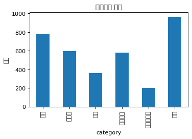
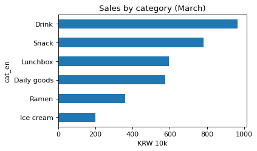

# 2-2 한글 라벨이 깨지면 영어로 다시

!!! abstract "이 절에서 할 일"
    한글 상품군 그대로 차트를 그리면 깨지는 모습을 보고, 사전으로 영어 이름을 붙여 다시 그린다.

```python
import matplotlib.pyplot as plt
by_cat = cvs.groupby("category")["amount"].sum() / 1e4      # 만원
by_cat.plot.bar(title="상품군별 매출", ylabel="만원", figsize=(5, 3))
plt.show()
```



상품군 이름 → 영어 이름 사전을 만들어 `rename` 한다. 표 안의 값은 그대로 두고 **그림에 쓸 이름만** 바꾼다.

```python
eng = {"과자": "Snack", "음료": "Drink", "도시락": "Lunchbox", "라면": "Ramen",
       "아이스크림": "Ice cream", "생활용품": "Daily goods"}
cvs["cat_en"] = cvs["category"].map(eng)
print("unmapped:", cvs["cat_en"].isna().sum())
by_cat = cvs.groupby("cat_en")["amount"].sum() / 1e4
by_cat.sort_values().plot.barh(title="Sales by category (March)", xlabel="KRW 10k", figsize=(5, 3))
plt.show()
```

```text title="실행 결과"
unmapped: 0
```



<div class="say" data-who="asst">표에서는 한글이 멀쩡한데 그림만 네모예요.</div>
<div class="say" data-who="doc">0-6 에서 본 그거예요. 그림 글꼴에 한글이 없어서요.</div>

!!! info "읽는 법"
    `map(eng)` 뒤에 `unmapped` 가 0 이어야 모든 상품군이 영어 이름을 받은 것이다. 가로 막대(`barh`)로 바꾸고 값 순서로 정렬하면 이름이 긴 상품군도 읽기 쉽다. 가장 큰 상품군은 Drink (965만원)이다.

!!! tip "바꿔 보기"
    `eng` 에서 `"생활용품"` 줄을 지워 본다. `unmapped` 가 늘고 그 막대가 그림에서 사라진다. 확인했으면 되돌린다.

<label class="done"><input type="checkbox" data-step="2-2"> 2-2 끝냈어요</label>
