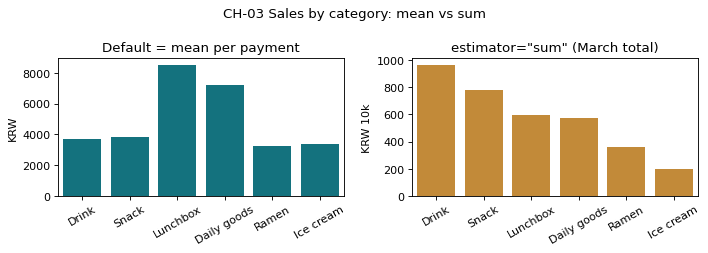

# 2-3 평균이냐 합계냐 · CH-03

!!! abstract "이 절에서 할 일"
    같은 데이터로 '결제 1건 평균'과 '합계'를 나란히 그려, 질문에 따라 막대 높이가 달라지는 것을 본다.

```python
t = cvs.groupby("cat_en")["amount"].agg(["mean", "sum", "count"])
t["sum"] = t["sum"] / 1e4
print(t.round(0).sort_values("sum", ascending=False))
```

```text title="실행 결과"
               mean    sum  count
cat_en                           
Drink        3725.0  965.0   2591
Snack        3850.0  780.0   2027
Lunchbox     8523.0  595.0    698
Daily goods  7230.0  577.0    798
Ramen        3259.0  360.0   1104
Ice cream    3399.0  201.0    592
```

CH-03. seaborn 의 `barplot` 은 기본이 **평균**이다. 합계를 보려면 `estimator="sum"` 을 꼭 넣는다.

```python
import seaborn as sns
order = t.sort_values("sum", ascending=False).index
fig, ax = plt.subplots(1, 2, figsize=(9, 3.2))
sns.barplot(data=cvs, x="cat_en", y="amount", order=order, errorbar=None, color="#028090", ax=ax[0])
ax[0].set(title="Default = mean per payment", xlabel="", ylabel="KRW")
cvs["amount_10k"] = cvs["amount"] / 1e4               # 합계는 커서 만원 단위로
sns.barplot(data=cvs, x="cat_en", y="amount_10k", order=order, estimator="sum", errorbar=None, color="#D98E22", ax=ax[1])
ax[1].set(title='estimator="sum" (March total)', xlabel="", ylabel="KRW 10k")
for a in ax: a.tick_params(axis="x", rotation=30)
fig.suptitle("CH-03 Sales by category: mean vs sum")
plt.tight_layout()
plt.show()
```



<div class="say" data-who="robo" data-state="confused">합계가 제일 크면 제일 잘 팔린 거지? 삐빅.</div>
<div class="say" data-who="doc">질문에 따라 달라요. 한 번에 많이 쓰는 건 Lunchbox, 한 달에 많이 번 건 Drink예요.</div>

!!! info "읽는 법"
    왼쪽(평균)은 "결제 한 번에 얼마나 쓰나", 오른쪽(합계)은 "한 달에 얼마 벌었나"에 답한다. Lunchbox 은 한 번에 8,523원으로 가장 비싸지만, 건수가 많은 Drink 가 합계 1위(965만원)다.

!!! tip "바꿔 보기"
    `estimator="sum"` 을 `estimator="count"` 로 바꿔 결제 건수 막대도 그려 본다.

<label class="done"><input type="checkbox" data-step="2-3"> 2-3 끝냈어요</label>
