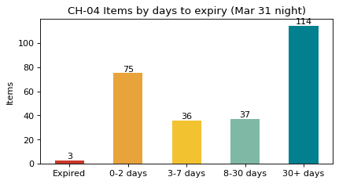

# 2-4 유통기한까지 며칠 남았나 · CH-04

!!! abstract "이 절에서 할 일"
    진열 상품마다 유통기한까지 남은 날을 계산하고, 구간(버킷)으로 묶어 오늘 밤 치워야 할 것을 센다.

```python
stock = pd.read_csv("cvs_stock.csv", encoding=enc, parse_dates=["expiry"])
today = pd.Timestamp("2025-03-31")
stock["days_left"] = (stock["expiry"] - today).dt.days
bins   = [-999, -1, 2, 7, 30, 9999]
labels = ["Expired", "0-2 days", "3-7 days", "8-30 days", "30+ days"]
stock["bucket"] = pd.cut(stock["days_left"], bins=bins, labels=labels)
bq = stock.groupby("bucket", observed=False)["qty"].sum()
print(bq)
print(stock[stock["days_left"] < 0][["product", "qty", "expiry"]])
```

```text title="실행 결과"
bucket
Expired        3
0-2 days      75
3-7 days      36
8-30 days     37
30+ days     114
Name: qty, dtype: int64
     product  qty     expiry
54      삼각김밥    2 2025-03-30
55  우유 200ml    1 2025-03-29
```

CH-04. 버킷 순서는 `labels` 순서 그대로 둔다. 급한 쪽을 빨갛게 칠한다.

```python
colors = ["#C9382A", "#E8A33A", "#F2C230", "#7FB8A4", "#028090"]
ax = bq.plot.bar(color=colors, figsize=(6, 3), rot=0,
                 title="CH-04 Items by days to expiry (Mar 31 night)", xlabel="", ylabel="Items")
ax.bar_label(ax.containers[0])
plt.show()
```



<div class="say" data-who="fly">유통기한 지난 게 3개 아직 진열대에 있다고?</div>

!!! info "읽는 법"
    `bins` 는 구간의 경계다. `(-1, 2]` 는 0~2일, `(-999, -1]` 은 이미 지난 것이다. 오늘 밤 치울 것 3개, 내일모레까지 팔아야 할 것 75개다. 구간 차트는 "얼마나 급한가"를 한눈에 보여 준다.

!!! tip "바꿔 보기"
    `today` 를 `pd.Timestamp("2025-04-02")` 로 바꿔 이틀 뒤의 모습을 본다.

<label class="done"><input type="checkbox" data-step="2-4"> 2-4 끝냈어요</label>
