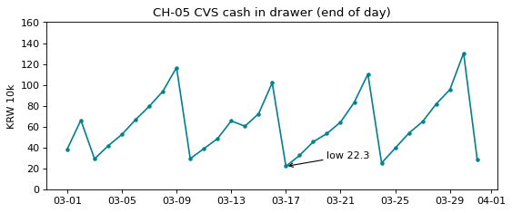

# 2-5 cumsum 으로 시재 다시 계산 · CH-05

!!! abstract "이 절에서 할 일"
    날마다 들어온 현금과 나간 현금으로 계산대 잔액(시재)을 다시 계산하고, 가장 낮은 날에 표시를 단 선 그림을 그린다.

```python
cash = pd.read_csv("cvs_cash.csv", encoding=enc, parse_dates=["date"])
opening = 200_000                                    # 3월 1일 아침 계산대 현금
cash["drawer"] = opening + (cash["cash_in"] - cash["cash_out"]).cumsum()
print(cash.head(4))
low = cash.loc[cash["drawer"].idxmin()]
print("lowest:", low["date"].date(), int(low["drawer"]))
```

```text title="실행 결과"
        date  cash_in  cash_out  drawer
0 2025-03-01   186900         0  386900
1 2025-03-02   276300         0  663200
2 2025-03-03   130500    500000  293700
3 2025-03-04   125700         0  419400
lowest: 2025-03-17 222800
```

CH-05. 가장 낮은 날에 화살표를 단다.

```python
fig, ax = plt.subplots(figsize=(8, 3))
ax.plot(cash["date"], cash["drawer"] / 1e4, color="#028090", marker=".")
ax.annotate(f"low {low['drawer'] / 1e4:.1f}", xy=(low["date"], low["drawer"] / 1e4),
            xytext=(low["date"] + pd.Timedelta(days=3), 30), arrowprops=dict(arrowstyle="->"))
ax.set(title="CH-05 CVS cash in drawer (end of day)", ylabel="KRW 10k", ylim=(0, 160))
import matplotlib.dates as mdates
ax.xaxis.set_major_formatter(mdates.DateFormatter("%m-%d"))   # 날짜는 월-일만
plt.show()
```



<div class="say" data-who="asst">월요일마다 뚝 떨어져요. 무슨 일이에요?</div>
<div class="say" data-who="doc">월요일 밤에 20만원만 남기고 은행에 넣어서 그래요. 톱니 모양이 정상이에요.</div>

!!! info "읽는 법"
    `cumsum` 은 위에서부터 차례로 더한 값이다. 기초 20만원에 날마다 (들어온 돈 − 나간 돈)을 쌓으면 그날 밤 계산대 잔액이 된다. 가장 낮은 날은 03-17 (222,800원)이다.

!!! tip "바꿔 보기"
    `opening` 을 `0` 으로 바꿔 본다. 선 모양은 같고 높이만 20만원 내려간다.

<label class="done"><input type="checkbox" data-step="2-5"> 2-5 끝냈어요</label>
