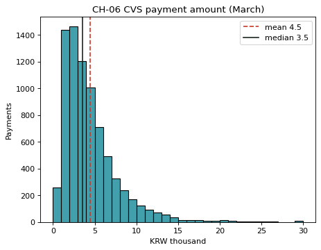

# 2-6 평균과 중앙값 · CH-06

!!! abstract "이 절에서 할 일"
    결제 금액의 평균과 중앙값을 비교하고, 히스토그램에 두 선을 그어 왜 다른지 본다.

```python
print("mean:  ", round(cvs["amount"].mean()))
print("median:", cvs["amount"].median())
print("top 5:", cvs["amount"].nlargest(5).tolist())
```

```text title="실행 결과"
mean:   4454
median: 3550.0
top 5: [50000, 50000, 50000, 50000, 50000]
```

CH-06. 금액을 천원 단위로 바꿔 0~30천원 구간만 그린다.

```python
k = cvs["amount"] / 1000
ax = sns.histplot(k, binwidth=1, binrange=(0, 30), color="#028090")
ax.axvline(k.mean(), color="#C9382A", linestyle="--", label=f"mean {k.mean():.1f}")
ax.axvline(k.median(), color="#1C2620", label=f"median {k.median():.1f}")
ax.set(title="CH-06 CVS payment amount (March)", xlabel="KRW thousand", ylabel="Payments")
ax.legend()
plt.show()
```



<div class="say" data-who="asst">평균은 4,454원인데 중앙값은 3,550원이에요.</div>

!!! info "읽는 법"
    결제 대부분은 1~6천원에 몰려 있고, 오른쪽으로 긴 꼬리가 있다. 몇 안 되는 큰 결제(최대 50,000원)가 평균을 끌어올린다. "보통 손님은 얼마를 쓰나"에는 중앙값이 더 정직한 답이다.

!!! tip "바꿔 보기"
    `binwidth=1` 을 `binwidth=0.5` 로 바꿔 막대를 더 잘게 나눠 본다.

<label class="done"><input type="checkbox" data-step="2-6"> 2-6 끝냈어요</label>
