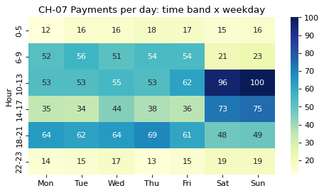

# 2-7 시간대 × 요일 피벗 · CH-07

!!! abstract "이 절에서 할 일"
    요일 × 시간대 표로 결제 수를 세고, 히트맵으로 붐비는 칸을 찾는다. 이 편의 질문(언제 바쁜가)에 대한 답이다.

```python
cvs["hour"] = cvs["time"].dt.hour
cvs["band"] = pd.cut(cvs["hour"], bins=[-1, 5, 9, 13, 17, 21, 23],
                     labels=["0-5", "6-9", "10-13", "14-17", "18-21", "22-23"])
days = ["Mon", "Tue", "Wed", "Thu", "Fri", "Sat", "Sun"]
pv = cvs.pivot_table(index="band", columns="weekday", values="receipt", aggfunc="count", observed=False)
pv = (pv[days] / cvs.groupby("weekday")["time"].apply(lambda s: s.dt.date.nunique())[days]).round(0)   # 하루 평균
print(pv)
```

```text title="실행 결과"
weekday   Mon   Tue   Wed   Thu   Fri   Sat    Sun
band                                              
0-5      12.0  16.0  16.0  18.0  17.0  15.0   16.0
6-9      52.0  56.0  51.0  54.0  54.0  21.0   23.0
10-13    53.0  53.0  55.0  53.0  62.0  96.0  100.0
14-17    35.0  34.0  44.0  38.0  36.0  73.0   75.0
18-21    64.0  62.0  64.0  69.0  61.0  48.0   49.0
22-23    14.0  15.0  17.0  13.0  15.0  19.0   19.0
```

CH-07. 하루 평균 결제 수를 색으로 칠한다.

```python
fig, ax = plt.subplots(figsize=(7, 3.6))
sns.heatmap(pv, annot=True, fmt=".0f", cmap="YlGnBu", ax=ax)
ax.set(title="CH-07 Payments per day: time band x weekday", xlabel="", ylabel="Hour")
plt.show()
```



<div class="say" data-who="asst">평일은 18-21시, 주말은 10-13시가 제일 바빠요.</div>
<div class="say" data-who="doc">그 칸에 사람을 더 두면 돼요. 이게 이 편 질문의 답이에요.</div>

!!! info "읽는 법"
    요일마다 날 수가 달라서(3월은 토 · 일 · 월이 5번) 칸마다 하루 평균으로 나눴다. 가장 진한 칸은 Sun 10-13시 (하루 100건)이다. 평일 아침 6-9시는 붐비지만 주말 아침은 한산하다.

!!! tip "바꿔 보기"
    `aggfunc="count"` 와 `values="receipt"` 를 `aggfunc="sum"`, `values="amount"` 로 바꿔 건수 대신 매출로 칠해 본다(나누기 줄은 빼고).

<label class="done"><input type="checkbox" data-step="2-7"> 2-7 끝냈어요</label>
