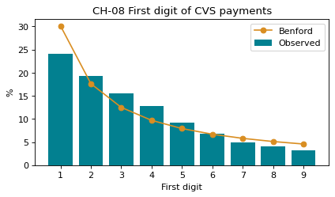

# 2-8 영수증 금액의 첫 자리 · CH-08

!!! abstract "이 절에서 할 일"
    결제 금액의 첫 자리 숫자(1~9) 비율을 세고, 벤포드 법칙의 기대값과 나란히 놓는다.

```python
import numpy as np
first = cvs["amount"].astype(str).str[0].astype(int)
obs = first.value_counts(normalize=True).sort_index() * 100
d = np.arange(1, 10)
benford = pd.Series(np.log10(1 + 1 / d) * 100, index=d)
cmp_ = pd.DataFrame({"observed%": obs.round(1), "benford%": benford.round(1)})
print(cmp_)
```

```text title="실행 결과"
   observed%  benford%
1       24.1      30.1
2       19.3      17.6
3       15.6      12.5
4       12.9       9.7
5        9.2       7.9
6        6.8       6.7
7        4.9       5.8
8        4.0       5.1
9        3.3       4.6
```

CH-08. 막대는 관측, 선은 벤포드 기대값이다.

```python
fig, ax = plt.subplots(figsize=(6, 3))
ax.bar(d, obs, color="#028090", label="Observed")
ax.plot(d, benford, color="#D98E22", marker="o", label="Benford")
ax.set(title="CH-08 First digit of CVS payments", xlabel="First digit", ylabel="%", xticks=d)
ax.legend()
plt.show()
```



<div class="say" data-who="fly">첫 자리가 1인 영수증이 왜 제일 많아?</div>
<div class="say" data-who="doc">여러 자릿수에 걸쳐 퍼진 금액은 원래 1로 시작하는 게 가장 많아요. 이번엔 24.1%예요.</div>

!!! info "읽는 법"
    벤포드 법칙은 1이 30.1%, 9가 4.6% 라고 기대한다. 편의점은 금액대가 좁아(대부분 1~6천원) 꼭 맞지는 않는다. 차이가 크게 나는 숫자는 "이상하다"가 아니라 "들여다볼 곳"이다. 다음 절에서 하나를 들여다본다.

!!! tip "바꿔 보기"
    `cvs["amount"]` 대신 `cvs.loc[cvs["pay"] == "Cash", "amount"]` 로 현금 결제만 세어 본다.

<label class="done"><input type="checkbox" data-step="2-8"> 2-8 끝냈어요</label>
