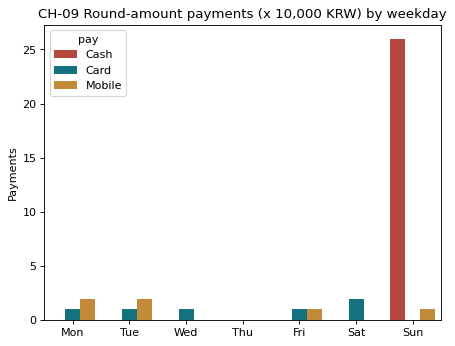

# 2-9 주말과 딱 떨어지는 금액 · CH-09

!!! abstract "이 절에서 할 일"
    요일별 하루 평균 결제 수를 다시 보고, 만원 단위로 딱 떨어지는 결제가 어느 요일 · 시각에 몰리는지 찾는다.

```python
nday = cvs.groupby("weekday")["time"].apply(lambda s: s.dt.date.nunique())
per_day = (cnt / nday)[days].round(0)
print(per_day)
cvs["round"] = cvs["amount"] % 10000 == 0           # 만원 단위로 딱 떨어지나
r = cvs[cvs["round"]]
print("round payments:", len(r))
print(r.groupby(["weekday", "pay"]).size().sort_values(ascending=False).head(4))
print("Sun 22-23h share:", round(((r["weekday"] == "Sun") & (r["hour"] >= 22)).mean() * 100), "%")
```

```text title="실행 결과"
weekday
Mon    229.0
Tue    236.0
Wed    247.0
Thu    245.0
Fri    247.0
Sat    273.0
Sun    281.0
dtype: float64
round payments: 38
weekday  pay   
Sun      Cash      26
Mon      Mobile     2
Sat      Card       2
Tue      Mobile     2
dtype: int64
Sun 22-23h share: 68 %
```

CH-09. 요일별로 딱 떨어지는 결제 수를 센다.

```python
ax = sns.countplot(data=r, x="weekday", order=days, hue="pay", palette=["#C9382A", "#028090", "#D98E22"])
ax.set(title="CH-09 Round-amount payments (x 10,000 KRW) by weekday", xlabel="", ylabel="Payments")
plt.show()
```



<div class="say" data-who="robo" data-state="wrong">삐빅! 딱 떨어지는 현금 결제가 일요일 밤에 몰려 있어.</div>
<div class="say" data-who="doc">틀렸다는 게 아니라 확인할 곳이라는 뜻이에요. 그 시간 근무표부터 봐요.</div>

!!! info "읽는 법"
    날 수로 나누면 그림이 달라진다. 월요일은 2-1 에서 3위(1,144건)였지만 하루 평균으로는 229건, 7개 요일 중 7위다. 만원 단위 결제 38건 가운데 68% 가 일요일 22~23시 현금이다. 포스기에 손으로 금액을 친 흔적일 수 있다.

!!! warning "데이터는 의심을 만들 뿐이다"
    이 그림만으로 누가 무엇을 했다고 말할 수 없다. 근무표, 영수증 원본, CCTV 처럼 다른 근거와 맞춰 본 다음에 판단한다.

!!! tip "바꿔 보기"
    `% 10000 == 0` 을 `% 1000 == 0` 으로 바꿔 본다. 천원 단위는 자연스러운 금액도 많아 요일 차이가 흐려진다.

<label class="done"><input type="checkbox" data-step="2-9"> 2-9 끝냈어요</label>

<div class="outro" markdown>
2편 정리

<div class="say" data-who="doc">① 질문이 차트를 고른다 ② 평균과 합계는 다른 답이다 ③ 답은 한 줄로 적는다</div>
<div class="say" data-who="asst">히트맵 한 장에 바쁜 시간이 다 보여요. 평일 18-21시, 주말 10-13시.</div>
<div class="say" data-who="fly">외국 손님은 원화 가격을 어떻게 읽어?</div>

[3편 해외 손님에게 가격을 알려 주자 →](../ep3/index.md)
</div>
