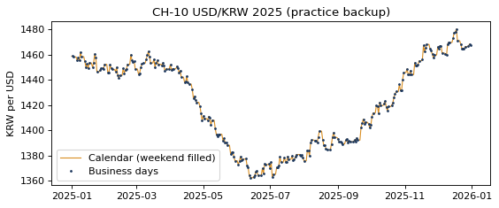

# 3-5 주말엔 환율이 없다 · CH-10

!!! abstract "이 절에서 할 일"
    주말 주문에 붙일 환율이 없는 문제를 확인하고, 달력 날짜로 펴서 직전 영업일 환율로 채운 뒤 주문에 붙인다.

```python
orders = pd.read_csv("shop_orders_global.csv", encoding=enc, parse_dates=["date"])
orders["fc"] = orders["qty"] * orders["unit_price"]          # 그 나라 돈으로 낸 금액
print(orders.head(3))
# 영업일 환율만 그대로 붙이면?
t1 = orders.merge(fx, left_on="date", right_index=True, how="left")
print("orders:", len(orders), "/ no rate:", t1["USDKRW=X"].isna().sum())
print(t1.loc[t1["USDKRW=X"].isna(), "date"].dt.day_name().value_counts())
```

```text title="실행 결과"
   order_id       date country currency   item  qty  unit_price     fc
0     50001 2025-01-01      US      USD  Denim    2        61.0  122.0
1     50002 2025-01-01      US      USD  Denim    2        61.0  122.0
2     50003 2025-01-01      US      USD  Shirt    1        26.5   26.5
orders: 1533 / no rate: 519
date
Saturday     262
Sunday       253
Wednesday      4
Name: count, dtype: int64
```

달력의 모든 날짜로 편 다음, 빈 날은 **바로 앞 영업일 값**으로 채운다(`ffill`). 1월 1일처럼 앞 값이 없는 날은 뒤 값으로 채운다(`bfill`).

```python
cal = pd.date_range("2025-01-01", "2025-12-31")
fxd = fx.reindex(cal).ffill().bfill()
fxd.index.name = "date"
print(fxd.loc["2025-01-03":"2025-01-06", ["USDKRW=X"]])
t2 = orders.merge(fxd, left_on="date", right_index=True, how="left")
print("no rate now:", t2["USDKRW=X"].isna().sum())
```

```text title="실행 결과"
            USDKRW=X
date                
2025-01-03    1458.1
2025-01-04    1458.1
2025-01-05    1458.1
2025-01-06    1455.6
no rate now: 0
```

CH-10. 영업일 점과 주말을 채운 선을 함께 그린다.

```python
import matplotlib.pyplot as plt
fig, ax = plt.subplots(figsize=(8, 3))
ax.plot(fxd.index, fxd["USDKRW=X"], color="#D98E22", linewidth=1, label="Calendar (weekend filled)")
ax.plot(fx.index, fx["USDKRW=X"], ".", color="#1F3A5F", markersize=3, label="Business days")
ax.set(title="CH-10 USD/KRW 2025 (practice backup)", ylabel="KRW per USD")
ax.legend()
plt.show()
```



<div class="say" data-who="fly">토요일 주문은 무슨 환율로 계산해?</div>
<div class="say" data-who="doc">규칙을 정하면 돼요. 여기선 '직전 영업일(금요일) 값'으로 해요.</div>

!!! info "읽는 법"
    그냥 붙이면 주문 1,533건 중 519건이 환율을 못 받는다. 거의 다 토 · 일 주문이다. `reindex` 로 달력 날짜를 모두 만든 뒤 `ffill` 하면 1월 4일(토) · 5일(일)이 3일(금) 값을 받는다. 채운 뒤에는 빈 줄이 0개다.

!!! warning "채우는 규칙은 적어 둔다"
    직전 값(ffill), 다음 값(bfill), 앞뒤 평균 중 무엇을 쓸지는 회사마다 다르다. 어떤 규칙을 썼는지 결과 옆에 꼭 적는다.

!!! tip "바꿔 보기"
    `.ffill().bfill()` 을 `.bfill()` 만으로 바꿔 본다. 토 · 일이 다음 월요일 값을 받는다.

<label class="done"><input type="checkbox" data-step="3-5"> 3-5 끝냈어요</label>
