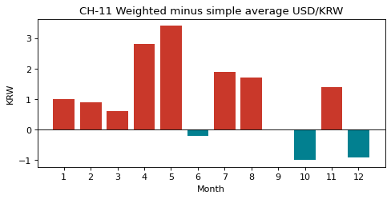

# 3-6 단순 평균 환율 vs 주문 가중 평균 환율 · CH-11

!!! abstract "이 절에서 할 일"
    달러 주문만 골라, 그달 환율의 단순 평균과 '주문이 들어온 만큼 무게를 둔' 가중 평균을 비교한다.

```python
us = t2[t2["currency"] == "USD"].copy()
us["krw"] = us["fc"] * us["USDKRW=X"]                  # 그날 환율로 바꾼 원화
us["month"] = us["date"].dt.month
g = us.groupby("month")[["fc", "krw"]].sum()
g["weighted"] = (g["krw"] / g["fc"]).round(1)                 # 주문 금액 가중 평균 환율
g["simple"] = fxd.groupby(fxd.index.month)["USDKRW=X"].mean().round(1)   # 달력 평균
g["diff"] = (g["weighted"] - g["simple"]).round(1)
print(g[["fc", "simple", "weighted", "diff"]])
print("year: simple", round(fxd["USDKRW=X"].mean(), 1), "/ weighted", round(us["krw"].sum() / us["fc"].sum(), 1))
```

```text title="실행 결과"
           fc  simple  weighted  diff
month                                
1      3744.0  1453.9    1454.9   1.0
2      2440.0  1449.1    1450.0   0.9
3      4426.5  1452.1    1452.7   0.6
4      3743.0  1436.6    1439.4   2.8
5      1791.0  1396.2    1399.6   3.4
6      1095.5  1370.1    1369.9  -0.2
7      1674.5  1375.2    1377.1   1.9
8      1558.0  1389.2    1390.9   1.7
9      2351.0  1395.5    1395.5   0.0
10     2086.5  1422.5    1421.5  -1.0
11     3798.5  1455.4    1456.8   1.4
12     4593.5  1467.7    1466.8  -0.9
year: simple 1421.8 / weighted 1435.4
```

CH-11. 달마다 두 평균을 나란히 놓는다. 차이가 작아서 차이만 따로 그린다.

```python
fig, ax = plt.subplots(figsize=(7, 3))
ax.bar(g.index, g["diff"], color=["#C9382A" if v > 0 else "#028090" for v in g["diff"]])
ax.axhline(0, color="black", linewidth=0.8)
ax.set(title="CH-11 Weighted minus simple average USD/KRW", xlabel="Month", ylabel="KRW", xticks=list(g.index))
plt.show()
```



<div class="say" data-who="asst">1년으로 보면 단순 평균은 1,421.8원, 가중 평균은 1,435.4원이에요.</div>
<div class="say" data-who="doc">주문은 달러가 비쌀 때 많이 들어왔어요. 그래서 가중 평균이 더 높아요.</div>

!!! info "읽는 법"
    가중 평균 = (원화 합계) ÷ (달러 합계). 주문이 많은 날의 환율이 더 큰 무게를 갖는다. 연간 차이는 13.6원이다. 달 안에서는 차이가 작지만(최대 3.4원), 1년을 한꺼번에 평균 내면 "언제 많이 팔렸나"가 섞여 차이가 커진다.

!!! tip "바꿔 보기"
    `currency == "USD"` 를 `"JPY"` 로, `USDKRW=X` 를 `JPYKRW=X` 로 바꿔 엔화 주문의 가중 평균을 구해 본다.

<label class="done"><input type="checkbox" data-step="3-6"> 3-6 끝냈어요</label>
