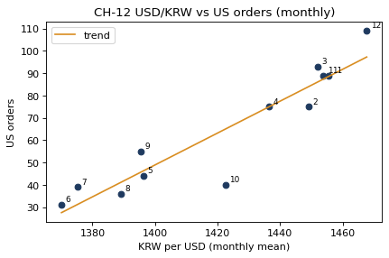

# 3-7 환율과 해외 주문 수 · CH-12

!!! abstract "이 절에서 할 일"
    달마다 원/달러 평균 환율과 미국 주문 수를 점으로 찍고, 추세선과 상관계수를 구한다.

```python
import numpy as np
m = pd.DataFrame({
    "usdkrw": fxd.groupby(fxd.index.month)["USDKRW=X"].mean(),
    "us_orders": t2[t2["country"] == "US"].groupby(t2["date"].dt.month).size(),
})
print(m.round(1))
slope, intercept = np.polyfit(m["usdkrw"], m["us_orders"], 1)
print("slope:", round(slope, 3), "/ corr:", round(m["usdkrw"].corr(m["us_orders"]), 2))
```

```text title="실행 결과"
      usdkrw  us_orders
date                   
1     1453.9         89
2     1449.1         75
3     1452.1         93
4     1436.6         75
5     1396.2         44
6     1370.1         31
7     1375.2         39
8     1389.2         36
9     1395.5         55
10    1422.5         40
11    1455.4         89
12    1467.7        109
slope: 0.714 / corr: 0.93
```

CH-12. 점마다 달 숫자를 붙인다.

```python
fig, ax = plt.subplots(figsize=(6, 3.6))
ax.scatter(m["usdkrw"], m["us_orders"], color="#1F3A5F")
for mon, r in m.iterrows():
    ax.annotate(str(mon), (r["usdkrw"], r["us_orders"]), xytext=(4, 3), textcoords="offset points", fontsize=8)
xs = np.linspace(m["usdkrw"].min(), m["usdkrw"].max(), 50)
ax.plot(xs, slope * xs + intercept, color="#D98E22", label="trend")
ax.set(title="CH-12 USD/KRW vs US orders (monthly)", xlabel="KRW per USD (monthly mean)", ylabel="US orders")
ax.legend()
plt.show()
```



<div class="say" data-who="robo" data-state="thinking">환율 오르면 주문도 오르는 거지? 삐빅.</div>
<div class="say" data-who="fly">같이 움직였을 뿐이야. 11 · 12월은 연말 쇼핑 철이기도 하잖아.</div>

!!! info "읽는 법"
    상관계수 0.93 은 둘이 강하게 같이 움직였다는 뜻이다. 추세선 기울기 0.714 은 "환율이 10원 높은 달에 미국 주문이 약 7.1건 많았다"로 읽는다. 하지만 이것만으로 **환율 때문에** 주문이 늘었다고 말할 수는 없다. 계절, 광고, 신상품처럼 함께 움직인 다른 이유를 따로 확인해야 한다.

!!! tip "바꿔 보기"
    `US` 를 `CN` 으로, `USDKRW=X` 를 `CNYKRW=X` 로 바꿔 본다. 중국 주문은 환율과 별 관계가 없게 만들었다.

<label class="done"><input type="checkbox" data-step="3-7"> 3-7 끝냈어요</label>
