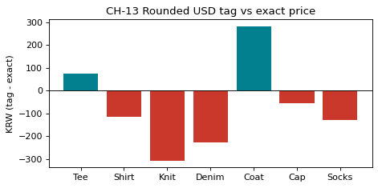

# 3-8 $0.50 단위로 반올림한 표시가 · CH-13

!!! abstract "이 절에서 할 일"
    가격표에 "$26.58" 대신 "$26.50" 처럼 0.5달러 단위로 보기 좋게 적었을 때, 상품마다 원화로 얼마나 덜(더) 받는지 계산한다.

```python
usd_rate = rate["USDKRW=X"]
tag["usd_tag"] = (tag["usd"] * 2).round() / 2          # 0.5 단위로 반올림
tag["diff_krw"] = (tag["usd_tag"] * usd_rate - tag["krw"]).round(0)
print(tag[["item", "krw", "usd", "usd_tag", "diff_krw"]])
print("total diff (one each):", tag["diff_krw"].sum())
```

```text title="실행 결과"
    item       krw     usd  usd_tag  diff_krw
0    Tee   19000.0   12.95     13.0      75.0
1  Shirt   39000.0   26.58     26.5    -117.0
2   Knit   59000.0   40.21     40.0    -308.0
3  Denim   89000.0   60.66     60.5    -228.0
4   Coat  189000.0  128.81    129.0     282.0
5    Cap   25000.0   17.04     17.0     -56.0
6  Socks    6000.0    4.09      4.0    -131.0
total diff (one each): -483.0
```

CH-13. 0 선 위는 더 받는 상품, 아래는 덜 받는 상품이다.

```python
fig, ax = plt.subplots(figsize=(6.5, 3))
ax.bar(tag["item"], tag["diff_krw"], color=["#028090" if v >= 0 else "#C9382A" for v in tag["diff_krw"]])
ax.axhline(0, color="black", linewidth=0.8)
ax.set(title="CH-13 Rounded USD tag vs exact price", ylabel="KRW (tag - exact)")
plt.show()
```



<div class="say" data-who="asst">가장 많이 덜 받는 건 Knit, 308원이에요.</div>
<div class="say" data-who="doc">한 벌에 그 정도면 보기 좋은 값을 고르는 비용으로 괜찮아요. 판단은 사장님 몫이에요.</div>

!!! info "읽는 법"
    `(x * 2).round() / 2` 는 0.5 단위 반올림이다. 차이는 상품마다 ±367원(0.25달러) 안에 들어온다. 모두 한 벌씩 팔리면 합계 -483원 차이다. 가격표를 바꿀지는 이 숫자를 보고 사람이 정한다.

!!! tip "바꿔 보기"
    `* 2` 와 `/ 2` 를 `* 1` 과 `/ 1` 로 바꿔 1달러 단위 반올림을 해 본다. 차이가 두 배쯤 커진다.

<label class="done"><input type="checkbox" data-step="3-8"> 3-8 끝냈어요</label>
