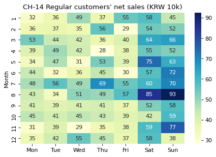

# 4-2 한 면 잘라 보기 · CH-14

!!! abstract "이 절에서 할 일"
    큐브에서 '단골(Regular)' 한 면만 잘라 월 × 요일 표로 펴고, 히트맵으로 그린다.

```python
days = ["Mon", "Tue", "Wed", "Thu", "Fri", "Sat", "Sun"]
regular = cube.xs("Regular", level="customer").unstack("weekday")[days] / 1e4    # 만원
print(regular.round(0))
share = cube.xs("Regular", level="customer").sum() / cube.sum()
print("regular share of sales:", round(share * 100, 1), "%")
```

```text title="실행 결과"
weekday   Mon   Tue   Wed   Thu   Fri   Sat   Sun
month                                            
1        32.0  36.0  49.0  37.0  55.0  58.0  45.0
2        36.0  37.0  35.0  56.0  29.0  54.0  52.0
3        53.0  44.0  42.0  36.0  40.0  64.0  66.0
4        39.0  49.0  42.0  28.0  38.0  55.0  52.0
5        34.0  47.0  31.0  53.0  39.0  75.0  63.0
6        44.0  32.0  36.0  45.0  30.0  57.0  72.0
7        48.0  56.0  49.0  69.0  55.0  60.0  70.0
8        43.0  34.0  51.0  49.0  57.0  85.0  93.0
9        41.0  39.0  41.0  41.0  37.0  52.0  58.0
10       45.0  41.0  45.0  43.0  39.0  42.0  59.0
11       31.0  39.0  29.0  35.0  38.0  59.0  77.0
12       35.0  42.0  55.0  45.0  37.0  58.0  38.0
regular share of sales: 36.7 %
```

CH-14. 단골 매출을 월 × 요일 칸에 칠한다.

```python
import matplotlib.pyplot as plt
import seaborn as sns
fig, ax = plt.subplots(figsize=(6.5, 4.2))
sns.heatmap(regular, annot=True, fmt=".0f", cmap="YlGnBu", ax=ax)
ax.set(title="CH-14 Regular customers' net sales (KRW 10k)", xlabel="", ylabel="Month")
plt.show()
```



<div class="say" data-who="fly">단골은 주말에 더 와? 아니면 평일에 와?</div>

!!! info "읽는 법"
    `xs("Regular", level="customer")` 는 큐브에서 손님 유형이 Regular 인 면만 잘라 낸다. 남은 두 방향(월, 요일) 중 요일을 열로 펴면 히트맵용 표가 된다. 단골 매출은 전체의 36.7% 이다. 칸 평균으로 주말은 61만원, 평일은 42만원이라 단골도 주말에 더 온다. 가장 큰 칸은 8월 Sun (93만원)이다.

!!! tip "바꿔 보기"
    `"Regular"` 를 `"Tourist"` 로 바꿔 관광객 면을 잘라 본다. 여름 주말이 진해진다.

<label class="done"><input type="checkbox" data-step="4-2"> 4-2 끝냈어요</label>
