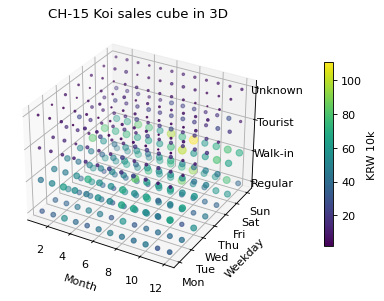

# 4-3 3D 산점, 정말 읽히나 · CH-15

!!! abstract "이 절에서 할 일"
    큐브 전체를 3D 점으로 찍어 보고, 2D 히트맵보다 읽기 쉬운지 직접 판단한다.

```python
import numpy as np
c = cube.reset_index()
c["d"] = c["weekday"].map({d: i for i, d in enumerate(days)})
types = ["Regular", "Walk-in", "Tourist", "Unknown"]
c["t"] = c["customer"].map({t: i for i, t in enumerate(types)})
fig = plt.figure(figsize=(6, 5))
ax = fig.add_subplot(projection="3d")
p = ax.scatter(c["month"], c["d"], c["t"], s=c["net"] / 2e4, c=c["net"] / 1e4, cmap="viridis")
ax.set(xlabel="Month", ylabel="Weekday", title="CH-15 Koi sales cube in 3D",
       yticks=range(7), yticklabels=days, zticks=range(4), zticklabels=types)
fig.colorbar(p, shrink=0.6, pad=0.15, label="KRW 10k")
plt.show()
```



가장 큰 칸이 어디인지 그림에서 찾아보고, 아래 답과 맞춰 본다.

```python
top = cube.idxmax()
print("largest cell:", top[0], top[1], top[2], "/", round(cube.max() / 1e4), "(KRW 10k)")
```

```text title="실행 결과"
largest cell: 8 Sun Walk-in / 111 (KRW 10k)
```

<div class="say" data-who="robo" data-state="thinking">3D면 더 멋지잖아? 삐빅.</div>
<div class="say" data-who="doc">멋있죠. 그런데 가장 큰 칸이 8월 Sun Walk-in 칸이라는 걸 그림만 보고 찾을 수 있나요?</div>

!!! info "읽는 법"
    점의 크기 · 색 · 위치가 서로 가리고, 보는 각도에 따라 앞뒤가 바뀐다. 3D 는 "모양이 있다"는 느낌을 줄 때는 좋지만 **값을 읽는 데는** 나쁘다. 보고서에는 4-2 처럼 한 면씩 잘라 2D 로 보여 주는 편이 정확하다.

!!! tip "바꿔 보기"
    `fig.add_subplot(projection="3d")` 아래에 `ax.view_init(elev=20, azim=-60)` 을 넣고 각도를 바꿔 본다. 같은 점이 다르게 보인다.

<label class="done"><input type="checkbox" data-step="4-3"> 4-3 끝냈어요</label>
