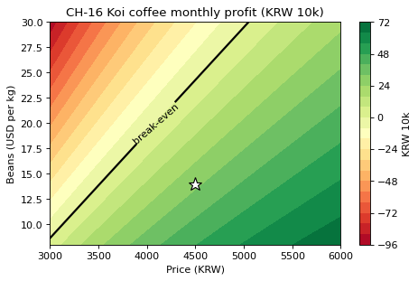

# 4-5 판매가 × 원두 단가 이익 등고선 · CH-16

!!! abstract "이 절에서 할 일"
    격자 이익을 등고선으로 그리고, 이익이 0 이 되는 선(손익분기선)을 굵게 표시한다.

```python
fig, ax = plt.subplots(figsize=(6.5, 4))
cf = ax.contourf(P, B, Z, levels=20, cmap="RdYlGn")
zero = ax.contour(P, B, Z, levels=[0], colors="black", linewidths=2)
ax.clabel(zero, fmt="break-even")
ax.plot(4500, 14, "w*", markersize=14, markeredgecolor="black")      # 지금 위치
ax.set(title="CH-16 Koi coffee monthly profit (KRW 10k)", xlabel="Price (KRW)", ylabel="Beans (USD per kg)")
fig.colorbar(cf, label="KRW 10k")
plt.show()
```



원두 값마다 손익이 0 이 되는 최소 판매가를 숫자로도 뽑는다.

```python
def breakeven(bean_usd, a):
    ok = prices[profit(prices, bean_usd, a) >= 0]
    return int(ok.min()) if len(ok) else None
for b in [10, 14, 20, 26]:
    print(f"beans ${b}/kg -> break-even price {breakeven(b, assume)}")
```

```text title="실행 결과"
beans $10/kg -> break-even price 3150
beans $14/kg -> break-even price 3550
beans $20/kg -> break-even price 4100
beans $26/kg -> break-even price 4700
```

<div class="say" data-who="asst">원두가 $14 에서 $20 으로 오르면 최소 4,100원은 받아야 해요.</div>
<div class="say" data-who="fly">근데 값을 올리면 손님이 줄잖아. 그것까지 들어간 거야?</div>

!!! info "읽는 법"
    초록은 이익, 빨강은 손실이다. 검은 선이 손익분기선이고, 흰 별이 지금 위치다. 선 오른쪽 아래로 갈수록 여유가 크다. 가격을 올리면 잔 수가 줄도록(탄력성) 함수에 넣었기 때문에, 가격을 올린다고 이익이 끝없이 늘지는 않는다.

!!! tip "바꿔 보기"
    `levels=20` 을 `levels=[-100, -50, 0, 50, 100]` 으로 바꿔 50만원 간격 선만 그려 본다.

<label class="done"><input type="checkbox" data-step="4-5"> 4-5 끝냈어요</label>
