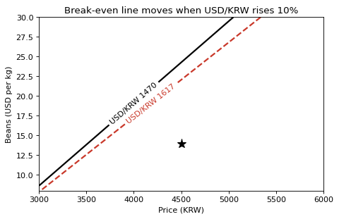

# 4-6 가정 바꾸기: 환율이 오르면

!!! abstract "이 절에서 할 일"
    환율 가정 하나만 10% 올려 다시 계산하고, 손익분기선이 어디로 움직이는지 두 선을 겹쳐 본다.

```python
hi = dict(assume)                       # 원래 가정은 그대로 두고 복사
hi["usdkrw"] = round(assume["usdkrw"] * 1.10)
Z2 = profit(P, B, hi) / 1e4
for b in [14, 20]:
    print(f"beans ${b}: break-even {breakeven(b, assume)} -> {breakeven(b, hi)}")
print("now profit:", round(profit(4500, 14, assume)), "->", round(profit(4500, 14, hi)))
```

```text title="실행 결과"
beans $14: break-even 3550 -> 3700
beans $20: break-even 4100 -> 4300
now profit: 300164 -> 259230
```

```python
fig, ax = plt.subplots(figsize=(6.5, 4))
c1 = ax.contour(P, B, Z, levels=[0], colors="black", linewidths=2)
c2 = ax.contour(P, B, Z2, levels=[0], colors="#C9382A", linewidths=2, linestyles="--")
ax.clabel(c1, fmt=f"USD/KRW {assume['usdkrw']}"); ax.clabel(c2, fmt=f"USD/KRW {hi['usdkrw']}")
ax.plot(4500, 14, "k*", markersize=12)
ax.set(title="Break-even line moves when USD/KRW rises 10%", xlabel="Price (KRW)", ylabel="Beans (USD per kg)")
plt.show()
```



<div class="say" data-who="fly">환율이 10% 뛰면 손익 0 선은 어디로 가?</div>
<div class="say" data-who="asst">원두 $20 기준으로 손익분기 가격이 4,100원에서 4,300원으로 올라요.</div>

!!! info "읽는 법"
    `dict(assume)` 로 복사해야 원래 가정이 바뀌지 않는다. 그냥 `hi = assume` 이라고 쓰면 두 이름이 같은 사전을 가리켜서 원래 값까지 바뀐다. 환율이 1,470 → 1,617원이 되면 원두 한 잔 값이 오르므로 손익분기선이 아래로 내려온다. 같은 가격에서 버틸 수 있는 원두 값이 낮아진다는 뜻이다. 지금 위치의 이익은 300,164원 → 259,230원이다.

!!! tip "바꿔 보기"
    `hi = dict(assume)` 를 `hi = assume` 으로 바꿔 실행한 뒤 `print(assume["usdkrw"])` 를 찍어 본다. 원래 가정까지 바뀐 것을 확인하고 되돌린다.

<label class="done"><input type="checkbox" data-step="4-6"> 4-6 끝냈어요</label>
