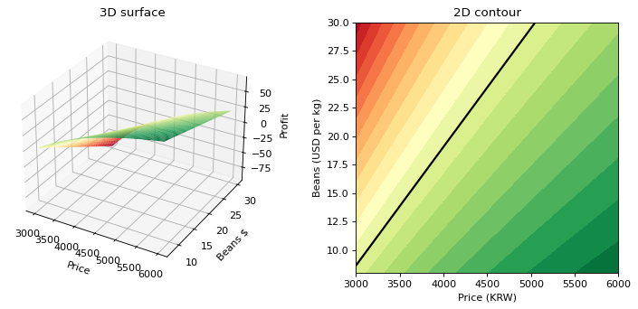

# 4-7 3D 곡면 vs 2D 등고선

!!! abstract "이 절에서 할 일"
    같은 격자를 3D 곡면과 2D 등고선으로 나란히 그려, 무엇이 더 잘 읽히는지 비교한다.

```python
fig = plt.figure(figsize=(11, 4.5))
ax1 = fig.add_subplot(1, 2, 1, projection="3d")
ax1.plot_surface(P, B, Z, cmap="RdYlGn")
ax1.set(title="3D surface", xlabel="Price", ylabel="Beans $", zlabel="Profit")
ax2 = fig.add_subplot(1, 2, 2)
ax2.contourf(P, B, Z, levels=20, cmap="RdYlGn")
ax2.contour(P, B, Z, levels=[0], colors="black", linewidths=2)
ax2.set(title="2D contour", xlabel="Price (KRW)", ylabel="Beans (USD per kg)")
fig.subplots_adjust(wspace=0.35)
plt.show()
```



<div class="say" data-who="robo" data-state="success">삐빅. 3D 가 멋있긴 한데 0 선은 오른쪽이 더 잘 보여.</div>

!!! info "읽는 법"
    3D 곡면은 "가격이 낮고 원두가 비싸면 크게 떨어진다"는 전체 모양을 한눈에 준다. 하지만 손익분기선이 어디인지, 지금 위치에서 얼마나 여유가 있는지는 2D 등고선에서 훨씬 정확하게 읽힌다. **설명할 때는 3D, 결정할 때는 2D.**

!!! tip "바꿔 보기"
    `plot_surface` 줄 아래에 `ax1.view_init(elev=35, azim=-130)` 을 넣어 다른 각도에서 본다.

<label class="done"><input type="checkbox" data-step="4-7"> 4-7 끝냈어요</label>
